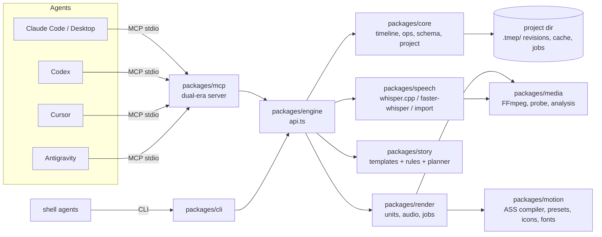

# Architecture



## Packages

| Package | Responsibility | Key files |
|---|---|---|
| `core` | schema validation (+JSON Schema), error codes, timeline model, anchors, ops, revisions, project store | `schema.ts`, `timeline.ts`, `ops.ts`, `project.ts` |
| `media` | safe subprocess runner (no shell, timeouts, abort), FFmpeg discovery/capabilities, probe, silence, loudness | `exec.ts`, `ffmpeg.ts` |
| `speech` | engine adapters, transcript normalization, subtitle/JSON import, sentence/keyword analysis, rough cut, BM25 search, Hinglish transliteration | `engines.ts`, `transcript.ts`, `analyze.ts`, `hinglish.ts` |
| `motion` | ASS document builder, caption styles, 11 presets, 30 original icons, font discovery | `captions.ts`, `presets.ts`, `icons.ts`, `fonts.ts`, `compile.ts` |
| `story` | templates (reel, short, talking_head, tutorial, product_demo, cinematic_explainer, youtube), storytelling rules, planner | `templates.ts`, `rules.ts`, `planner.ts` |
| `render` | unit planning, FFmpeg graph builders, audio mix, SFX synthesis, orchestration, jobs | `graph.ts`, `render.ts`, `jobs.ts`, `sfx.ts` |
| `engine` | the API used by MCP and CLI | `api.ts` |
| `mcp` | MCP stdio server and tool definitions | `server.ts`, `tools.ts` |
| `cli` | `tmep` command | `main.ts` |

Packages import each other by relative path and run as TypeScript directly (Node >= 22.18 type
stripping), so a clone works with no build or install step. Runtime dependencies: **none**
besides FFmpeg (and optionally a speech engine). Dev dependencies: `typescript`, `@types/node`.

## Data model

A **timeline** (`core/src/timeline.ts`) is a JSON document:

- `settings` (ratio, w, h, fps, bg)
- `clips[]`: `{src, in, out, speed, fit, cx, cy, base, push, zoom[], trans?, vol, mute}`. Clips
  play in sequence; `trans` overlaps a clip with its predecessor.
- `broll[]`, `gfx[]`, `sfx[]`: items positioned by a `TimeRef` (`{src, t}` source anchor, or
  `{at}` absolute timeline time)
- `captions` (style and corrections), `music`, `loudness`, `meta`

Timeline math is frame-quantized: `layout()` assigns integer frame counts to every clip, so
segment boundaries, audio length and caption timing never drift.

## Planning (no LLM)

1. **Rough cut** (`speech/analyze.ts`): split into sentences (punctuation or pauses), score
   (content-word density, transcript keywords, numbers, lists, penalties for fillers and
   fragments), always keep the hook (first sentence) and a closing call to action, fill to the
   target, then drop fillers and cap pauses at the template's `maxGap`.
2. **Framing**: alternate 1.0/1.08 scale across jump cuts (hides the jump), optional slow push-in.
3. **Storyboard** (`story/rules.ts`): detect enumerations (icon cards timed to each item),
   statistics (count-up callouts), steps (badges), calls to action (pill), emphasis words
   (punch zooms), keywords (for explainers). A density limiter enforces gaps, slides
   lower-priority graphics into free space, and drops what does not fit.
4. **Transitions** only at topic jumps (skipped content), with handles cut from silence.
5. **Sound design**: synthesized pop/click/ding/whoosh/swoosh/riser placed on accepted events.

## Rendering

```
timeline --layout--> placed clips --planUnits--> units (split at hard cuts)
         --compileAss--> gfx.ass (captions + presets) + fonts/
unit i:  ffmpeg -ss/-t inputs -> fps -> fit -> perspective zoom -> xfade -> b-roll overlay
         -> setpts(+unitStart) -> subtitles(gfx.ass) -> x264  => cache/units/<hash>.mp4
audio:   speech stem j: <=32 clips, per-clip trims (+atempo, 12-15 ms edge fades)
                        -> acrossfade/concat            => cache/audio/stems/<hash>.wav
         sfx stem k:    <=32 effects start here, placed with adelay (plus those still
                        sounding; <=6 inputs)           => cache/audio/stems/<hash>.wav
         final pass:    concat(speech stems) + music ducked by sidechaincompress
                        + concat(sfx stems) -> amix -> loudnorm => cache/audio/<hash>.m4a
final:   concat demuxer (stream copy) + audio mux -> faststart MP4 -> ffprobe verification
```

- Units are content-hashed; edits re-encode only touched units, previews (`scale 0.5`,
  `ultrafast`) and segment previews (`range`) render subsets, and interrupted renders resume.
- Video is encoded once (no intermediate re-encode). Audio is still one continuous programme —
  the stems are lossless 32-bit float PCM joined by the concat demuxer, and only the final pass
  encodes — so there are still no AAC priming gaps at joins.
- **No FFmpeg command grows with the length of the timeline** (`audio.ts`). The mix used to be
  a single process with one input per audible clip, which passed Windows' 32,767-character
  command-line limit at roughly 360 clips (`spawn ENAMETOOLONG`) and opened one file per clip.
  Audio is now built in stages, none of which depends on the clip count: speech stems of at most
  32 clips (and at most ~8 KB of input arguments), sound-effect windows in which at most 32
  effects start, then one final pass with at most three inputs (speech list, music, effects
  list). Measured:
  at most 21 inputs and ~7.6 KB of command line from 50 to 5,000 clips, and peak memory flat at
  ~180 MB where the single pass reached 1.5 GB at 800 clips.
- An effect window's **inputs** are bounded (one per distinct effect file: six), its **streams**
  are not: it mixes every effect audible in it, including those still sounding from earlier
  windows, so dense overlaps make one process with as many filter chains as effects sound at
  once. That is cheap far beyond any real sound design (400 simultaneous effects: 69 MB,
  0.24 s; 1,000: 118 MB, 0.9 s) and superlinear after that (5,000: 1 GB, 19 s). There is no
  hard cap; if one is ever needed, the way to add it is to mix an over-full window in layers.
- Audio positions are **sample-exact**: frame `f` is sample `round(f * 48000 / fps)`, and every
  trim, pad, fade and crossfade is expressed in samples (`atrim=end_sample`, `apad=whole_len`,
  `afade=ns`, `acrossfade=ns`). The single pass rounded each clip to milliseconds, which
  accumulated: a timeline of 60 clips with speed changes ended up ~1,040 samples (22 ms) short.
- Stems are content-hashed by what they contain, not by where they are, so an edit that shifts
  the rest of the timeline does not invalidate it; only the stems around the edit are re-mixed
  (measured on a 120-clip timeline: 1 of 9, and 3 of 11 on another FFmpeg, because the chunk
  boundaries themselves follow clip content). Identical passages share one stem. The cost is
  cache size: stems are ~366 KB per second of programme (about 117 MB for a 5-minute reel),
  which makes the outstanding cache-eviction work (audit C) matter more.
- Filters whose output depends on how samples are framed are given a fixed frame size
  (`asetnsamples`): `sidechaincompress` ducks identically however the speech was chunked, which
  matters because the chunk boundaries depend on the clips' own path lengths.
- FFmpeg runs with `cwd` = job directory and relative ASS/font paths (Windows-safe). Commands
  whose filter graph would make them longer than 16k characters pass the graph in a file
  instead (`-filter_complex_script`, or `-/filter_complex` on FFmpeg 8).
- Every render is verified with ffprobe (duration within 2 frames, resolution, audio stream).
- **Known limit:** a video unit still takes one input per clip, so a timeline whose every cut is
  a crossfade (one single unit) can still exceed the command-line limit at a few hundred clips.
  Hard cuts, which is what long timelines are made of, are one input per unit.

## Jobs

Renders and transcriptions run as jobs (`render/jobs.ts`) persisted to `.tmep/jobs/<id>.json`
with throttled progress. Any process can read them; cancellation works in-process
(AbortController kills FFmpeg) or across processes: the canceller creates
`.tmep/jobs/<id>.cancel`, which the owner polls every second. The request is never written into
the job record, so the owner's progress writes cannot overwrite it and a late request cannot
overwrite a final state; a request that arrives after the job finished is discarded. (A
`cancel: true` flag written by older versions is still honoured.) The marker is
published atomically (temp file + rename): the owner takes its existence as the request, so a
write that fails leaves no marker, is reported as `E_IO`, and cancels nothing.
Tools wait up to `wait` seconds, then return the job id.

**Concurrency.** Renders of the same project are queued in-process (phase `queued`) and run one
at a time; they share content-addressed cache entries, so a queued preview or a repeated final
reuses what the previous render produced. Different projects render in parallel. Across
processes, per-attempt temp names plus atomic rename keep the cache consistent: a duplicate
publish either replaces the entry with an equivalent complete file (POSIX) or, if the rename
fails (Windows), keeps the existing entry after validating it.
Mutable work files (ASS scripts, staged fonts, long filter-graph scripts, concat lists) live in a
private per-render directory, `.tmep/work/render-<pid>-<random>/`, which is removed when the
render ends; renders never share or lock each other's work files. FFmpeg runs with that
directory as `cwd` and fixed relative file names, so output and cache keys do not depend on it.
Within a render, the first failure (video unit, audio mix or mux) aborts all sibling FFmpeg
processes, temp files are removed, and the root-cause error is returned on the job; a failing
audio mix can no longer take down the host process.

**Stale jobs.** A running job refreshes `.tmep/jobs/<id>.alive` every 2 s and records its `pid`
and `host`. A job file that says `running` but belongs to a dead process on this host (or whose
heartbeat is older than 60 s) is reported, and persisted, as `error` / `E_INTERRUPTED`. The stale
heartbeat is removed only after that error record is on disk, so if the write fails the next
reader still sees the evidence and reports `E_INTERRUPTED` again. Older job records without
`host` are checked by pid.

**Job records.** Job JSON is written atomically (temp file + rename). On Windows a rename (or a
read) can fail briefly with a sharing violation while another process, antivirus or indexer holds
the file; these `EPERM`/`EACCES`/`EBUSY` errors are retried with short backoff (about 2.8 s, or
about 6.5 s for terminal states), and a write that still fails removes its temp file. On Windows
CI, other processes polling a record every 10 ms made 2-5% of plain renames fail. A job is
finalized only after its `done`/`error`/`cancelled` record is on disk. If that write keeps
failing, the job reports `persistErr` (`E_IO`) to the owning process instead of failing
silently; that process keeps answering from memory and retries on the next read, while other
processes see the job as `E_INTERRUPTED` once its (no longer refreshed) heartbeat goes stale or
the process exits. Failed progress writes are counted in `persistFailures`.

## Design decisions (ADR summary)

| # | Decision | Why | Trade-off |
|---|---|---|---|
| 1 | Zero runtime dependencies; own ~250-line schema module instead of Zod | run from a clone with `node`; exact control over compact JSON Schema for MCP; reproducible | less expressive than Zod; API mirrors a Zod subset to allow swapping |
| 2 | ASS/libass motion layer instead of a headless browser | one render pass, low RAM, deterministic, cross-platform | effects limited to what libass can animate (transforms, moves, fades, clips, vector shapes); no arbitrary CSS/WebGL |
| 3 | Remotion not used (optional bridge planned) | license is not OSI open source; company license for 4+ people | React-level graphics need an external tool for now (import as alpha overlays) |
| 4 | Segment (unit) rendering + continuous audio | caching, partial re-render, previews, resumability | concat requires identical encoder params per unit (enforced) |
| 5 | Source-time anchors for all speech-linked items | edits keep effects in sync without agent re-planning | items on deleted words are dropped (reported via `skipped` in debug) |
| 6 | 8 MCP tools + on-demand help | tool definitions are paid on every agent turn | agents may call `video_help` once to learn ops |
| 7 | Dual-era MCP server | works with handshake (2024-11-05 .. 2025-11-25) and stateless (2026-07-28) clients | two code paths in `server.ts` (small) |
| 8 | Node type stripping, no build | minimal friction; same files for dev and run | requires Node >= 22.18; publishing to npm would need a `tsc` emit step |
